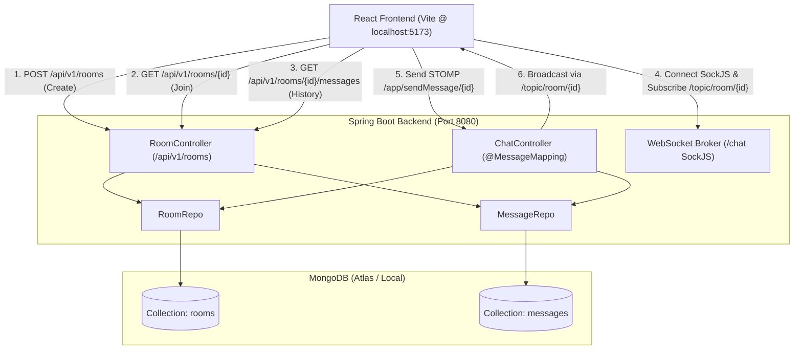

# Comprehensive Project Analysis: Spring Boot & React Chat Application

**Analysis Date:** October 2026  
**Target Repository:** `/Users/r.n_pathak/Documents/New_Chatapp_backend`  
**Application Name:** `New_Chatapp_backend`  

---

## 1. Project Overview & Repository Scope

### 1.1 Scope & Context
This repository contains the **backend service** for a real-time room-based chat application built with **Spring Boot** and **MongoDB**, communicating with a **React** single-page application (SPA) via REST APIs and WebSockets (STOMP over SockJS).

> [!IMPORTANT]
> **Repository Scope Clarification:**  
> The current workspace contains **only the Spring Boot backend**. The React frontend is developed in a separate workspace or directory (referenced in backend CORS configuration as `http://localhost:5173`, the default port for Vite + React). This analysis covers the backend implementation in full, defines the frontend contract, and outlines the integration flow.

### 1.2 Technology Stack

| Layer | Technology | Version | Purpose |
| :--- | :--- | :--- | :--- |
| **Language** | Java | 21 (Runtime: OpenJDK 25.0.1 LTS) | Application execution environment |
| **Framework** | Spring Boot | 4.0.5 (Spring Framework 7.0.6) | Core application framework |
| **Data Access** | Spring Data MongoDB | 5.0.4 (Driver: 5.6.4) | NoSQL persistence with MongoDB |
| **Messaging** | Spring WebSocket + STOMP | 7.0.6 (SockJS fallback) | Real-time bidirectional message broker |
| **HTTP Server** | Apache Tomcat (Embedded) | 11.0.20 | Servlet container for REST endpoints |
| **Boilerplate** | Project Lombok | 1.18.44 | Getter/Setter/Constructor generation |
| **Build Tool** | Apache Maven Wrapper (`mvnw`) | 3.9.14 | Build lifecycle and dependency management |
| **Frontend (Target)**| React (Vite-based) | Target: Node.js 18+ / React 18+ | Expected client on `http://localhost:5173` |

### 1.3 Dependencies (`pom.xml`)

* `org.springframework.boot:spring-boot-starter-web`: REST endpoints, Jackson serialization, embedded Tomcat.
* `org.springframework.boot:spring-boot-starter-data-mongodb`: Spring Data MongoDB repositories and mapping.
* `org.springframework.boot:spring-boot-starter-websocket`: WebSocket infrastructure and STOMP message broker support.
* `org.springframework.boot:spring-boot-devtools`: Hot reload and developer tooling (runtime, optional).
* `org.projectlombok:lombok`: Code generation annotations (`@Getter`, `@Setter`, `@NoArgsConstructor`, `@AllArgsConstructor`).
* `org.springframework.boot:spring-boot-starter-test`: Testing dependencies (JUnit Jupiter 6.0.3, Mockito 5.20.0, AssertJ).

### 1.4 Directory Structure

```
New_Chatapp_backend/
├── .mvn/
│   └── wrapper/
│       └── maven-wrapper.properties
├── src/
│   ├── main/
│   │   ├── java/com/substring/chat/New_Chatapp_backend/
│   │   │   ├── config/
│   │   │   │   ├── AppConstants.java          # CORS & client origin constants
│   │   │   │   └── webSocketConfig.java       # STOMP broker & SockJS endpoint setup
│   │   │   ├── controllers/
│   │   │   │   ├── ChatController.java        # WebSocket STOMP message handler
│   │   │   │   └── RoomController.java        # REST controller for rooms & message history
│   │   │   ├── entities/
│   │   │   │   ├── Message.java               # MongoDB document for chat messages
│   │   │   │   └── Room.java                  # MongoDB document for chat rooms
│   │   │   ├── payload/
│   │   │   │   └── MessageRequest.java        # Inbound DTO for WebSocket messages
│   │   │   ├── repo/
│   │   │   │   ├── MessageRepo.java           # Spring Data repository for Message
│   │   │   │   └── RoomRepo.java              # Spring Data repository for Room
│   │   │   └── NewChatappBackendApplication.java # Application main & CommandLineRunner
│   │   └── resources/
│   │       └── application.properties         # Server port & MongoDB configuration
│   └── test/
│       └── java/com/substring/chat/New_Chatapp_backend/
│           └── NewChatappBackendApplicationTests.java # Context loading integration test
├── HELP.md
├── mvnw                                       # Unix Maven wrapper script
├── mvnw.cmd                                   # Windows Maven wrapper script
└── pom.xml                                    # Maven POM configuration
```

---

## 2. Application Architecture & Complete Data Flow

### 2.1 Architecture Overview

The system uses a **hybrid REST + STOMP WebSocket** architecture:
1. **REST APIs** handle room lifecycle (creating a room, verifying room existence, and loading previous message history).
2. **WebSocket (STOMP over SockJS)** handles real-time live messaging within active chat rooms.
3. **MongoDB** persists rooms and messages with Time-To-Live (TTL) timestamps for automatic data cleanup.



### 2.2 End-to-End User Flow (Join to Real-time Chat)

1. **User Identity & "Login":**
   * *Actual implementation:* There is **no server-side authentication or user entity**. The frontend prompts the user for a display name (e.g., `sender: "Alice"`) and a room ID. This state is maintained strictly on the client side.
2. **Room Creation / Verification:**
   * User enters a room ID and clicks "Create" $\rightarrow$ Frontend issues `POST /api/v1/rooms` with `roomId`.
   * User clicks "Join" $\rightarrow$ Frontend issues `GET /api/v1/rooms/{roomId}` to confirm existence.
3. **History Retrieval:**
   * Frontend requests previous chat history by calling `GET /api/v1/rooms/{roomId}/messages`.
   * Server returns array of `Message` documents, which the client populates into its chat scrollback.
4. **WebSocket Connection & Subscription:**
   * Frontend establishes a SockJS connection to `http://localhost:8080/chat`.
   * Over STOMP protocol, client subscribes to:  
     `SUBSCRIBE destination:/topic/room/{roomId}`
5. **Sending & Broadcasting Messages:**
   * User types message and hits send.
   * Client transmits a STOMP frame:
     * Destination: `/app/sendMessage/{roomId}`
     * Body: `{"sender": "Alice", "content": "Hello world", "roomId": "room101"}`
   * `ChatController.sendMessage` validates room existence in `RoomRepo`.
   * Server constructs `Message`, stamps `new Date()`, saves it into MongoDB via `MessageRepo.save()`.
   * Controller returns the entity, which is dispatched by Spring SimpleBroker to `/topic/room/{roomId}`.
   * All subscribed clients in that room receive the frame and append the message to their chat window.

---

## 3. API Endpoints, WebSocket Flow & Database Schema

### 3.1 REST API Specification

All REST endpoints are rooted at `/api/v1/rooms` and allow CORS requests from `http://localhost:5173`.

| Method | Endpoint | Request Body | Headers | Response Status & Body | Description |
| :--- | :--- | :--- | :--- | :--- | :--- |
| `POST` | `/api/v1/rooms` | Raw String (`roomId`) | `Content-Type: text/plain` or raw string | **201 Created**: `Room` object<br>**400 Bad Request**: `"Room already exist!"` | Creates a new room with a creation timestamp |
| `GET` | `/api/v1/rooms/{roomId}` | *None* | *None* | **200 OK**: `Room` object<br>**400 Bad Request**: `"Room Doesn't exist!"` | Checks if a room exists before joining |
| `GET` | `/api/v1/rooms/{roomId}/messages` | *None* | *None* | **200 OK**: `List<Message>` JSON<br>**400 Bad Request**: empty body (if room not found) | Retrieves all past messages for a room |

### 3.2 WebSocket & STOMP Protocol Specification

Configured in `webSocketConfig.java`:
* **SockJS Handshake URL:** `http://localhost:8080/chat`
* **Allowed Origin:** `http://localhost:5173` (via `AppConstants.FRONT_END_BASE_URL`)
* **Application Destination Prefix:** `/app`
* **Broker Prefix:** `/topic`

#### Inbound Destination (Client $\rightarrow$ Server)
* **Destination:** `/app/sendMessage/{roomId}`
* **Payload Structure (`MessageRequest`):**
  ```json
  {
    "sender": "JohnDoe",
    "content": "Hello everyone!",
    "roomId": "dev-chat"
  }
  ```

#### Outbound Topic (Server $\rightarrow$ Subscribed Clients)
* **Destination:** `/topic/room/{roomId}`
* **Broadcast Payload (`Message` entity):**
  ```json
  {
    "id": "6714ea8f12a4b872c91a8e10",
    "roomId": "dev-chat",
    "sender": "JohnDoe",
    "content": "Hello everyone!",
    "timeStamp": "2026-10-21T06:20:00.000+00:00"
  }
  ```

### 3.3 Database Entities & TTL Collections

#### 1. Entity: `Room` (Collection: `rooms`)
Mapped in `com.substring.chat.New_Chatapp_backend.entities.Room`:
* `id` (`String`): MongoDB primary document key (`@Id`).
* `roomId` (`String`): User-specified room identifier (e.g., `"room101"`).
* `createdAt` (`Date`): Timestamp annotated with `@Indexed(expireAfterSeconds = 43200)` (12-hour TTL).

#### 2. Entity: `Message` (Collection: `messages`)
Mapped in `com.substring.chat.New_Chatapp_backend.entities.Message`:
* `id` (`String`): MongoDB primary document key (`@Id`).
* `roomId` (`String`): Identifier of the parent room.
* `sender` (`String`): Display name of the user who sent the message.
* `content` (`String`): Text body of the message.
* `timeStamp` (`Date`): Timestamp annotated with `@Indexed(expireAfterSeconds = 21600)` (6-hour TTL).

### 3.4 Authentication Mechanism

* **Current Implementation:** **None.**
* There is no Spring Security starter, no JWT filter, no session token, and no password authentication implemented in the backend. Senders are arbitrary client-supplied strings with no validation or authorization check.

---

## 4. Execution & Setup Guide

### 4.1 Prerequisites

1. **JDK 21 or later** (Verified working on Oracle JDK 25 LTS).
2. **MongoDB Database:**
   * Either local MongoDB instance running at `mongodb://localhost:27017`
   * Or a working MongoDB Atlas cluster URI.
3. **Node.js (v18+) & npm** (for running the React client).

### 4.2 Configuration & Environment Setup

The backend configuration is managed in `src/main/resources/application.properties`.

#### Current Configuration:
```properties
spring.application.name=New_Chatapp_backend
server.port=8080

# Recommended configuration pattern (avoiding hardcoded secrets):
spring.data.mongodb.uri=${MONGODB_URI:mongodb://localhost:27017/chatapp}
spring.data.mongodb.auto-index-creation=true
```

> [!CAUTION]
> **Production Safety Notice:** Never commit actual database passwords or connection strings to source control. Use environment variables (such as `MONGODB_URI`) instead.

### 4.3 Running the Backend

From the repository root (`/Users/r.n_pathak/Documents/New_Chatapp_backend`):

1. **Build and test compile:**
   ```bash
   ./mvnw compile
   ```
2. **Run the Spring Boot application:**
   ```bash
   ./mvnw spring-boot:run
   ```
3. **Or package into an executable JAR and run:**
   ```bash
   ./mvnw clean package -DskipTests
   java -jar target/New_Chatapp_backend-0.0.1-SNAPSHOT.jar
   ```
4. **Backend verification:**
   * Backend will be listening on HTTP port `8080`.
   * Confirm console output displays: `Tomcat started on port 8080 (http) with context path '/'`.

### 4.4 Running the React Frontend

The React frontend runs as a separate client application connecting to this backend:

1. **Locate or initialize the React project** (e.g., `New_Chatapp_frontend`):
   ```bash
   cd /path/to/New_Chatapp_frontend
   ```
2. **Install required dependencies:**
   ```bash
   npm install @stomp/stompjs sockjs-client axios react-router-dom
   ```
3. **Start the frontend development server:**
   ```bash
   npm run dev
   ```
4. **Ports & URLs:**
   * Frontend: `http://localhost:5173`
   * Backend: `http://localhost:8080`

---

## 5. Existing Features & Implementation Status

| Feature | Component | Status | Notes |
| :--- | :--- | :--- | :--- |
| **Room Creation** | `RoomController.createRoom` | **Functional** | Creates room document with `createdAt` timestamp. |
| **Room Validation** | `RoomController.joinroom` | **Functional** | Validates if room ID exists in MongoDB. |
| **Message History** | `RoomController.getMessages` | **Functional** | Retrieves room messages (unsorted, non-paginated). |
| **STOMP Broker** | `webSocketConfig` | **Functional** | In-memory SimpleBroker (`/topic`) with `/chat` SockJS endpoint. |
| **Live Chat** | `ChatController.sendMessage` | **Functional** | Persists message to MongoDB and broadcasts to room subscribers. |
| **Ephemeral Data (TTL)** | `@Indexed(expireAfterSeconds)` | **Incomplete / Non-functional** | Annotations present, but `auto-index-creation` is disabled by default in Spring Data MongoDB. |
| **User Authentication** | System-wide | **Not Implemented** | No Spring Security, no JWT, no user credentials or sessions. |
| **Message Ordering** | `MessageRepo` | **Incomplete** | Queries do not specify `ORDER BY timeStamp ASC`. |
| **Message Pagination** | `MessageRepo` | **Not Implemented** | All messages loaded into memory at once; risk of unbounded memory consumption. |
| **Input Validation** | Controllers / DTOs | **Not Implemented** | No `@Valid`, `@NotBlank`, or size restrictions on content/sender/roomId. |

---

## 6. Code Issues, Bugs, Security Risks & Incomplete Features

Each item below indicates whether it is a **[Confirmed Issue]** (verified through direct code review and test execution) or a **[Potential Problem]** (architectural risk under production or concurrent conditions).

### 6.1 Critical & High Severity Issues

#### 1. Hardcoded Database Credentials in Repository
* **Status:** `[Confirmed Issue]`
* **File:** `src/main/resources/application.properties` (lines 4–5)
* **Description:** A live MongoDB Atlas connection string containing username and password was committed directly in `application.properties`.
* **Impact:** Anyone with read access to the repository can inspect and compromise the database cluster.
* **Fix:** Replace hardcoded credentials with environment variable placeholders:
  ```properties
  spring.data.mongodb.uri=${SPRING_DATA_MONGODB_URI:mongodb://localhost:27017/chatapp}
  ```

#### 2. Invalid / Unresolvable MongoDB Atlas Cluster DNS
* **Status:** `[Confirmed Issue]`
* **File:** `src/main/resources/application.properties` (lines 4–5)
* **Description:** Test execution revealed that the configured SRV record (`_mongodb._tcp.chat-app-cluster.juyoary.mongodb.net`) fails with `com.mongodb.MongoConfigurationException: Failed looking up SRV record ... DnsWithResponseCodeException: DNS name not found [response code 3]`.
* **Impact:** Any database write or read operation (`createRoom`, `joinroom`, `getMessages`, `sendMessage`) will fail or hang until timeout.
* **Fix:** Verify and update the connection string to an active MongoDB Atlas cluster, or use a local MongoDB instance for development.

#### 3. TTL Auto-Index Creation Is Inactive
* **Status:** `[Confirmed Issue]`
* **Files:** 
  * `src/main/resources/application.properties`
  * `src/main/java/com/substring/chat/New_Chatapp_backend/entities/Room.java` (line 28)
  * `src/main/java/com/substring/chat/New_Chatapp_backend/entities/Message.java` (line 29)
* **Description:** `@Indexed(expireAfterSeconds = ...)` is placed on `Room.createdAt` and `Message.timeStamp`. However, Spring Data MongoDB disables automatic index creation by default. Without explicit configuration, MongoDB never creates the TTL indexes.
* **Impact:** Rooms and messages are **never automatically deleted**, violating the ephemeral chat design.
* **Fix:** Add this property to `application.properties`:
  ```properties
  spring.data.mongodb.auto-index-creation=true
  ```

#### 4. Java Class Naming Convention Violation
* **Status:** `[Confirmed Issue]`
* **File:** `src/main/java/com/substring/chat/New_Chatapp_backend/config/webSocketConfig.java` (line 14)
* **Description:** The class is named `webSocketConfig` with a lowercase `w`.
* **Impact:** Violates standard Java PascalCase naming conventions; can lead to compilation or packaging discrepancies between case-insensitive file systems (macOS/Windows) and case-sensitive systems (Linux CI/CD).
* **Fix:** Rename the class and file to `WebSocketConfig`.

---

### 6.2 Medium & Architecture Issues

#### 5. Unhandled Exception in WebSocket Message Mapping
* **Status:** `[Confirmed Issue]`
* **File:** `src/main/java/com/substring/chat/New_Chatapp_backend/controllers/ChatController.java` (line 40)
* **Description:** When a message is sent to a nonexistent room:
  ```java
  if(room == null){
      throw new RuntimeException("room not found!!");
  }
  ```
  There is no `@MessageExceptionHandler` defined.
* **Impact:** The runtime exception is swallowed or terminates the WebSocket message broker frame abruptly without providing feedback to the sender.
* **Fix:** Add a dedicated `@MessageExceptionHandler` or return an error response frame to a client-specific destination (e.g., `/topic/room/{roomId}/errors` or `/user/queue/errors`).

#### 6. Raw String RequestBody in `createRoom`
* **Status:** `[Confirmed Issue]`
* **File:** `src/main/java/com/substring/chat/New_Chatapp_backend/controllers/RoomController.java` (line 32)
* **Description:**
  ```java
  @PostMapping
  public ResponseEntity<?> createRoom(@RequestBody String roomId)
  ```
* **Impact:** If a client sends JSON payload `{"roomId": "general"}`, `createRoom` receives the raw JSON string as the room name. Furthermore, empty strings, whitespace, or invalid characters are accepted without validation.
* **Fix:** Create a structured DTO `RoomRequest` with Jakarta validation:
  ```java
  public class RoomRequest {
      @NotBlank(message = "Room ID cannot be empty")
      @Pattern(regexp = "^[a-zA-Z0-9_-]{3,20}$", message = "Invalid Room ID format")
      private String roomId;
  }
  ```

#### 7. Unsorted and Unpaginated Message Retrieval
* **Status:** `[Confirmed Issue]`
* **Files:**
  * `src/main/java/com/substring/chat/New_Chatapp_backend/controllers/RoomController.java` (line 70)
  * `src/main/java/com/substring/chat/New_Chatapp_backend/repo/MessageRepo.java` (line 13)
* **Description:** `messageRepo.findByRoomId(roomId)` does not sort by `timeStamp` and does not accept pagination parameters (`Pageable`).
* **Impact:** Messages may be displayed out of chronological sequence. In long-running rooms, retrieving thousands of messages simultaneously risks high latency and memory spikes (`OutOfMemoryError`).
* **Fix:** Update repository method to:
  ```java
  List<Message> findByRoomIdOrderByTimeStampAsc(String roomId, Pageable pageable);
  ```

#### 8. Duplicate / Deprecated MongoDB Property
* **Status:** `[Confirmed Issue]`
* **File:** `src/main/resources/application.properties` (lines 4–5)
* **Description:** Both `spring.data.mongodb.uri` and `spring.mongodb.uri` are specified. `spring.mongodb.uri` is a legacy property.
* **Impact:** Redundant configuration and potential confusion during environment variable overrides.
* **Fix:** Remove line 5 (`spring.mongodb.uri`).

#### 9. Hardcoded CORS Origin
* **Status:** `[Potential Problem]`
* **Files:**
  * `src/main/java/com/substring/chat/New_Chatapp_backend/config/AppConstants.java` (line 4)
  * `src/main/java/com/substring/chat/New_Chatapp_backend/config/webSocketConfig.java` (line 25)
  * `src/main/java/com/substring/chat/New_Chatapp_backend/controllers/RoomController.java` (line 18)
  * `src/main/java/com/substring/chat/New_Chatapp_backend/controllers/ChatController.java` (line 20)
* **Description:** `FRONT_END_BASE_URL="http://localhost:5173"` is hardcoded as a static string constant.
* **Impact:** If the React app is served on a different port, behind a reverse proxy, or deployed to a staging/production domain, all requests will be blocked by CORS.
* **Fix:** Externalize CORS origin to `application.properties`:
  ```properties
  cors.allowed-origins=http://localhost:5173
  ```
  Inject it using `@Value("${cors.allowed-origins}")`.

#### 10. Lack of Input Sanitization (Stored XSS Risk)
* **Status:** `[Potential Problem]`
* **File:** `src/main/java/com/substring/chat/New_Chatapp_backend/controllers/ChatController.java` (line 45)
* **Description:** Message content is saved and broadcast directly as received without sanitization.
* **Impact:** If the frontend renders message text using `dangerouslySetInnerHTML` or an unescaped markdown parser, an attacker can broadcast malicious JavaScript payloads to all room participants.
* **Fix:** Sanitize text inputs on the backend or ensure the frontend strictly renders content as plain text.

#### 11. Race Condition on Room Creation
* **Status:** `[Potential Problem]`
* **File:** `src/main/java/com/substring/chat/New_Chatapp_backend/controllers/RoomController.java` (lines 33–44)
* **Description:** `createRoom` checks `if(roomRepo.findByRoomId(roomId) != null)` then executes `save(room)`. However, `Room.roomId` does not have a unique index in MongoDB (`@Indexed(unique = true)`).
* **Impact:** Concurrent creation requests with identical `roomId` can result in duplicate room documents in the database.
* **Fix:** Add `@Indexed(unique = true)` to `roomId` in `Room.java` or make `roomId` the `@Id`.

---

## 7. Build & Verification Results

### 7.1 Compilation Check (`./mvnw compile`)
* **Result:** **SUCCESS**
* **Time:** 0.377s
* **Finding:** All Java sources, Lombok annotations, and dependencies compile without syntax errors on JDK 25 with Java 21 target compatibility.

### 7.2 Test Suite Execution (`./mvnw test`)
* **Result:** **COMPLETED WITH CONNECTION WARNING**
* **Tests Executed:** `NewChatappBackendApplicationTests.contextLoads()` (1 test, 0 failures, 0 errors, 1.214s elapsed).
* **Runtime Diagnostic Log:**
  ```
  Exception while resolving SRV records
  com.mongodb.MongoConfigurationException: Failed looking up SRV record for '_mongodb._tcp.chat-app-cluster.juyoary.mongodb.net'.
  Caused by: com.mongodb.spi.dns.DnsWithResponseCodeException: DNS name not found [response code 3]
  ...
  =================================
  CONNECTED TO: ClusterDescription{type=UNKNOWN, srvResolutionException=com.mongodb.MongoConfigurationException: Failed looking up SRV record...}
  =================================
  ```
* **Analysis:** The Spring test context initializes successfully because MongoDB connections are lazy. However, the database cluster is unreachable. The application cannot execute read/write operations against the database in its current state.

---

## 8. Prioritized Roadmap for Remediation

### Phase 1: Immediate Blockers & Security (Day 1)
1. **Remove hardcoded database credentials** from `application.properties` and replace with environment variable references.
2. **Resolve MongoDB connection**: Point `spring.data.mongodb.uri` to a functioning MongoDB Atlas cluster or a local Dockerized MongoDB instance (`mongodb://localhost:27017/chatapp`).
3. **Enable automatic index creation** by adding `spring.data.mongodb.auto-index-creation=true` to ensure TTL indexes operate.

### Phase 2: Code Quality & Stability (Day 2)
1. **Rename class** `webSocketConfig` to `WebSocketConfig` following standard Java naming conventions.
2. **Implement DTOs with validation** for `createRoom` instead of accepting raw text bodies.
3. **Add `@MessageExceptionHandler`** in `ChatController` to gracefully report errors over WebSockets rather than throwing uncaught runtime exceptions.
4. **Remove redundant `spring.mongodb.uri`** property from configuration.

### Phase 3: Robustness & Data Integrity (Day 3)
1. **Add chronological ordering and pagination** to `MessageRepo.findByRoomId` (`Pageable` support) to prevent unbounded memory growth.
2. **Enforce unique constraint** on `Room.roomId` (`@Indexed(unique = true)`).
3. **Dynamic CORS configuration**: Externalize allowed origins to application properties.

### Phase 4: Security & Authentication (Future Milestone)
1. Add Spring Security starter and implement lightweight JWT or session-based authentication.
2. Authenticate WebSocket connections during the initial handshake.
3. Associate message sender with the authenticated principal rather than trusting client-provided sender strings.
